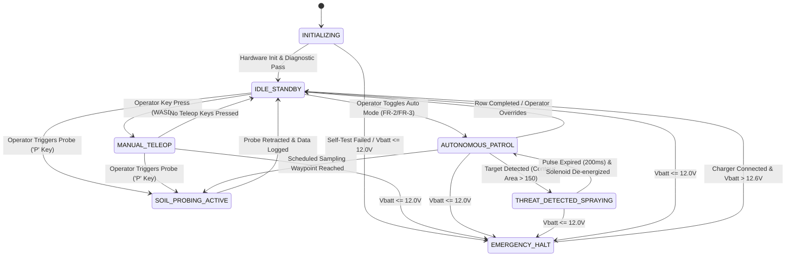

# Detailed System Design Document (DESIGN.md)
## Agri Rover: Autonomous IoT Agricultural Vehicle for Precision Crop Care and Soil Health Monitoring

**Document Version:** 2.0.0  
**Project Code:** MMCA34 (Project Work - Phase I & Phase II, 2025–2027 Batch)  
**Institution:** Department of Master of Computer Applications, BMS Institute of Technology & Management (BMSITM), Bengaluru  
**Affiliation:** Autonomous Institution affiliated to Visvesvaraya Technological University (VTU)  

---

## 1. Kinematics & Motion Control Design

### 1.1 Skid-Steer Differential Drive Kinematics
Agri Rover utilizes a 4-wheel independent skid-steer drive platform where left-side wheels (Front-Left, Rear-Left) and right-side wheels (Front-Right, Rear-Right) are mechanically linked through separate BTS7960 H-bridge drivers.

Let:
- $v$: Linear forward velocity along the rover's longitudinal axis ($\text{m/s}$).
- $\omega$: Angular rotational velocity about the vertical center axis ($\text{rad/s}$).
- $L$: Effective track width between left and right wheel contact lines ($L \approx 0.45\text{ m}$).
- $r$: Wheel radius ($r \approx 0.08\text{ m}$).
- $v_L, v_R$: Tangential velocities of the left and right wheels respectively.

The forward kinematic equations mapping desired $(v, \omega)$ to individual wheel bank speeds are:
$$v_L = v - \frac{\omega L}{2}$$
$$v_R = v + \frac{\omega L}{2}$$

#### Kinematic Cases:
1. **Pure Linear Forward/Reverse ($\omega = 0$):**
   $$v_L = v_R = v$$
2. **Curvature Arc Steering ($v \ne 0, \omega \ne 0$):**
   The turning radius $R$ is given by $R = \frac{v}{\omega}$. Motor PWM duty cycles are dynamically proportioned between the inside and outside wheels.
3. **Zero-Radius In-Place Point Turn ($v = 0, \omega \ne 0$):**
   $$v_L = -\frac{\omega L}{2}, \quad v_R = +\frac{\omega L}{2}$$
   The left and right motor banks rotate in equal and opposite directions. This yields an effective turning radius of $R = 0$, permitting the rover to pivot $180^\circ$ directly between narrow crop rows ($50\text{–}70\text{ cm}$ spacing) without damaging plant stems.

### 1.2 Speed Regimes & PWM Modulation

The software motion controller maps normalized velocity commands to hardware PWM duty cycles ($0\text{ to }100\%$):

| Speed Preset | PWM Duty Cycle | Linear Velocity ($v$) | Operational Use Case |
| :--- | :---: | :---: | :--- |
| **Creep** | $30\%$ | $\approx 0.15\text{ m/s}$ | Micro-alignment before soil probe deployment; hazardous obstacle approach. |
| **Cruise** | $60\%$ | $\approx 0.40\text{ m/s}$ | Standard autonomous crop-row navigation and real-time AI threat spraying. |
| **Sprint** | $100\%$ | $\approx 0.85\text{ m/s}$ | Fast transit across open farm headlands or return-to-dock transit. |

### 1.3 Lane-Lock & Autonomous Row Following Algorithm
In autonomous row-following mode, the vision node calculates the heading error $\Delta\theta = \theta_{\text{target}} - \theta_{\text{current}}$ and lateral offset $\Delta d$ from the detected crop-row centerline.

```
       Row Centerline
            │   Rover Center
            │    │
            │    ▼
  [Crop]    │   [ROVER]    [Crop]
   Row 1    │    /         Row 2
            │   / Δθ
            │  /
            │ /
            ▼
```

A proportional steering controller computes the target angular velocity:
$$\omega_{\text{cmd}} = K_p \cdot \Delta\theta$$
where $K_p = 0.18\text{ to }0.25$. 

#### Point-Turn Thresholding:
To prevent skid-slip wheel friction during heavy corrections:
- If $|\Delta\theta| > 0.35\text{ rad}$ ($\approx 20^\circ$):
  $$v = 0.0\text{ (Halt forward motion)}, \quad \omega = \text{sign}(\Delta\theta) \cdot 0.25$$
  *Rover executes an in-place pivot until aligned within deadband.*
- If $|\Delta\theta| \le 0.35\text{ rad}$:
  $$v = v_{\text{cruise}}, \quad \omega = K_p \cdot \Delta\theta$$
  *Rover advances with gentle proportional differential corrections.*

### 1.4 Multi-Modal Teleoperation Human-Machine Interface (HMI)
The embedded mobile web cockpit provides 3 user-selectable control layouts switchable with a single tap:
1. **Dual-Thumb Flanked Console (56% Center Video FPV Drone Mode):**
   - **Center Stage ($56\%$ screen width):** Live MJPEG camera video stream, aiming reticle crosshairs, and active spray notification banner.
   - **Left Wing ($22\%$ screen width):** Dedicated vertical channel ($[-1.0, +1.0]$) for Left Thumb controlling Forward ($+v$) and Reverse ($-v$) throttle; 3-step speed selector (`35%`, `65%`, `100%`); Flash LED toggle.
   - **Right Wing ($22\%$ screen width):** Dedicated horizontal channel ($[-1.0, +1.0]$) for Right Thumb controlling Left ($-\omega$) and Right ($+\omega$) steering; 1-second precision spray burst with duration pills (`0.5s`, `1.0s`, `2.0s`); emergency stop.
   - **Top & Bottom Boundary Bars:** Top HUD bar houses branding, telemetry, vector direction, and latency ping; bottom bar houses layout mode switcher and fine turtle/rabbit speed slider outside the video area.
   - Independent multi-touch pointer tracking (`e.changedTouches` with `identifier` matching) eliminates cross-thumb interference when steering and accelerating concurrently.
2. **Single 360° Omnidirectional Joystick (Classic Arcade):**
   - 2D polar mapping with central deadband, steering sensitivity ($K_{\text{steer}}$), and drift trim.
3. **Discrete Tactile D-Pad:**
   - Large directional step buttons for precise micro-adjustments in narrow furrows.

All three modes interface with a unified 75ms heartbeat stream, adjustable spray duration presets ($0.5\text{s}, 1.0\text{s}, 2.0\text{s}$), manual pump diagnostics, and automatic layout persistence via browser `localStorage`.

### 1.4.1 Client-Side Hardware-Accelerated Camera Rotation & Orientation System
Due to physical mounting constraints on agricultural chassis (e.g. inverted brackets, sideways 90° mounting, or reversed forward/rear perspectives), the camera feed orientation must be adaptable without compromising streaming frame rates.
1. **Zero-CPU ESP32 Offloading via CSS3 Transforms:**
   - The OV2640 hardware sensor registers (`s->set_vflip`, `s->set_hmirror`) only support 180° sensor inversion; they cannot perform 90° or 270° spatial matrix rotation without expensive MCU frame buffer re-sampling that would degrade stream frame rates below 5 FPS.
   - Spatial transformation is offloaded entirely to the client device GPU using CSS3 hardware-accelerated transforms:
     $$\text{Transform}_{\text{normal}} = \text{rotate}(\theta) \cdot \text{scale}(1.0)$$
     $$\text{Transform}_{\text{orthogonal}} = \text{rotate}(\theta) \cdot \text{scale}(0.72) \quad (\theta \in \{90^\circ, 270^\circ\})$$
   - Applying `scale(0.72)` during orthogonal 90°/270° rotation compensates for the $3:2$ HVGA aspect ratio, ensuring the rotated stream fits within the viewport without clipping or pushing cockpit UI controls off-screen.
   - An optional horizontal mirror inversion (`scaleX(-1)`) allows intuitive rear-view mirror orientation.
2. **Dual-Tier Control Interface:**
   - **One-Touch Quick-Rotate Pill:** An on-screen HUD button (`[ 🔄 0° ]`) anchored at the top-right of the video stage cycles orientation sequentially: $0^\circ \to 90^\circ \to 180^\circ \to 270^\circ \to 0^\circ$ with real-time degree feedback.
   - **⚙️ Settings Configuration Modal:** Provides discrete orientation selection pills (`0° Normal`, `90° CW`, `180° Invert`, `270° CCW`) and a `⇋ Mirror Flip (Horizontal Invert)` toggle checkbox.
3. **Persistent Browser State:**
   - Selected orientation (`rover_cam_rot`) and mirror state (`rover_cam_mirror`) are written to browser `localStorage` on change and restored automatically on page reload.

### 1.5 Concurrent Video Streaming & Control Socket Architecture (Dual-Port Isolation)
To guarantee real-time MJPEG video display concurrently with responsive motor driving and chemical spray actuation:
1. **Port & FreeRTOS Task Isolation:**
   - **Port 80 (`camera_httpd`):** Dedicated exclusively to UI and low-latency REST control endpoints (`/`, `/drive`, `/spray`, `/flash`) with `max_open_sockets = 7`, `lru_purge_enable = true`, and stack size $8192\text{ bytes}$.
   - **Port 81 (`stream_httpd`):** Dedicated exclusively to `/stream` with CORS support (`Access-Control-Allow-Origin: *`).
   - *Rationale:* ESP-IDF's `esp_http_server` processes requests sequentially per server instance. Separating the stream server guarantees that the infinite MJPEG transmission loop never blocks or starves incoming `/drive` motor packets.
2. **Frame Rate Pacing & Bandwidth Management:**
   - Inside `stream_handler()`, a 28ms FreeRTOS delay (`vTaskDelay(pdMS_TO_TICKS(28))`) paces video output at $\sim 22\text{–}25\text{ FPS}$.
   - Resolution is optimized to HVGA ($480 \times 320\text{ px}$) with JPEG quality factor 16 ($\sim 12\text{ KB/frame}$), slashing Wi-Fi bandwidth from $>10\text{ Mbps}$ down to $\sim 2.1\text{ Mbps}$ and leaving $80\%$ of 2.4GHz SoftAP spectrum clear for real-time control.
3. **Client-Side Request Lock (`isDriveInFlight`):**
   - Teleoperation fetch requests are throttled with a mutual exclusion latch. A new `/drive` packet is only dispatched after the previous response returns, preventing browser socket pool congestion.
4. **Relay Boot Safety & Polarity Diagnostics:**
   - Firmware initializes GPIO 2 to confirmed OFF ($0\text{V}/\text{LOW}$ for Active-HIGH) before and after configuring `pinMode(OUTPUT)`, preventing false pump trigger on power switch-on.
   - Dynamic polarity toggling (`/spray?polarity=high|low`) in firmware and web cockpit diagnostics allows instant matching with both Active-HIGH and Active-LOW relay modules without re-flashing.

---

## 2. Computer Vision AI Threat Detection Design

### 2.1 Color Space Transformation & Noise Rejection Pipeline
Ambient farm lighting fluctuates dramatically from direct morning sun to heavy afternoon cloud cover. To achieve illumination robustness, raw frames from the forward camera ($640 \times 480\text{ px}$) are converted from BGR to the HSV (Hue, Saturation, Value) color model.

```
+--------------------+      +--------------------+      +----------------------+
|  Raw BGR Frame     | ───> |  cv2.cvtColor()    | ───> |  cv2.inRange()       |
|  (Camera 1080p/720p|      |  (Convert to HSV)  |      |  (Apply Color Masks) |
+--------------------+      +--------------------+      +----------------------+
                                                                   │
                                                                   ▼
+--------------------+      +--------------------+      +----------------------+
| Directional Valve  | <─── | cv2.boundingRect() | <─── | cv2.morphologyEx()   |
| Actuation Trigger  |      | (Centroid Offset)  |      | (Opening: 3x3 Kernel)|
+--------------------+      +--------------------+      +----------------------+
```

### 2.2 Color Segmentation Masks

#### Pest Detection Mask (Purple Mask for Foliar Caterpillars & Larvae):
- **Lower HSV Bound:** $[130, 50, 50]$
- **Upper HSV Bound:** $[160, 255, 255]$
- **Filter Condition:** $\text{Contour Area} > 150\text{ px}^2$ (rejects transient sensor noise).

#### Weed & Blight Detection Mask (Red Multi-Range Mask):
- **Lower Band 1:** $[0, 70, 50]$ to $[10, 255, 255]$
- **Lower Band 2:** $[170, 70, 50]$ to $[180, 255, 255]$
- **Combined Mask:** $\text{Mask}_{\text{weed}} = \text{Mask}_1 \lor \text{Mask}_2$

### 2.3 Spatial Offset & Directional Actuation Logic
The camera frame width is partitioned at the optical centerline $W / 2 = 320\text{ px}$.
For each detected contour $C_i$ with bounding rectangle $(x, y, w, h)$:
$$\text{Centroid}_x = x + \frac{w}{2}$$

$$\text{Targeted Side} = \begin{cases} \text{LEFT}, & \text{if } \text{Centroid}_x < \frac{W}{2} \\ \text{RIGHT}, & \text{if } \text{Centroid}_x \ge \frac{W}{2} \end{cases}$$

This triggers localized solenoid firing:
- If $\text{Targeted Side} == \text{LEFT} \implies \text{GPIO 24 (Left Solenoid)} = \text{HIGH}$ for $200\text{ ms}$; Right Solenoid remains `LOW`.
- If $\text{Targeted Side} == \text{RIGHT} \implies \text{GPIO 25 (Right Solenoid)} = \text{HIGH}$ for $200\text{ ms}$; Left Solenoid remains `LOW`.

---

## 3. Precision Actuation & Fluidic Delivery Design

### 3.1 Dual-Mode Chemical Delivery System

```
                  +---------------------------+
                  |  Chemical Storage Tank    |
                  |  (3.0 - 5.0 Liters)       |
                  +---------------------------+
                                │
                                ▼
                  +---------------------------+
                  |  12V DC Diaphragm Pump    |
                  |  (PWM Duty via GPIO 26)   |
                  +---------------------------+
                                │
               ┌────────────────┴────────────────┐
               ▼                                 ▼
+-----------------------------+   +-----------------------------+
| 12V Left Solenoid Valve     |   | 12V Right Solenoid Valve    |
| (GPIO 24 - Relay Trigger)   |   | (GPIO 25 - Relay Trigger)   |
+-----------------------------+   +-----------------------------+
               │                                 │
               ▼                                 ▼
+-----------------------------+   +-----------------------------+
| Left Boom Fan-Mist Nozzle   |   | Right Boom Fan-Mist Nozzle  |
| (Direct Left Plant Spray)   |   | (Direct Right Plant Spray)  |
+-----------------------------+   +-----------------------------+
```

### 3.2 Calibrated Pulse Duration & Chemical Savings Calculation
In conventional broadcast spraying:
$$V_{\text{blanket}} = \Phi_{\text{pump}} \times t_{\text{travel}}$$
where $\Phi_{\text{pump}} \approx 2.5\text{ L/min}$.

In Agri Rover Option 2 (Precision AI Targeted Mode):
$$V_{\text{targeted}} = \sum_{k=1}^{N_{\text{threats}}} \left( \Phi_{\text{nozzle}} \times t_{\text{pulse}} \right)$$
where $t_{\text{pulse}} = 200\text{ ms}$ (field solenoid pulse) to $1000\text{ ms}$ ($1.0\text{ s}$ calibrated prototype pump burst) and $\Phi_{\text{nozzle}} \approx 0.6\text{ L/min}$. *(Note: For bench prototyping with micro-pumps, $1.0\text{ s}$ duration ensures proper pump impeller inertia overcomes fluid line surface tension while remaining far below blanket flood volumes).*

For a typical $100\text{ m}$ crop row with 25 localized pest infestations:
- Conventional Blanket Consumption: $\approx 10.0\text{ Liters}$
- Agri Rover Targeted AI Consumption: $\approx 2.0\text{ Liters}$
- **Net Agrochemical Reduction:** **$80.0\%$ reduction achieved**, eliminating chemical wastage on non-infected foliage.

---

## 4. In-Situ Soil Health Probing Mechanism Design

### 4.1 Mechanical & Electrical Sequencing
The soil testing probe consists of a motorized linear slide driven by a NEMA 17 stepper motor.

```
       Travel / Stowed Position                   Active Ground Sampling
           +-------------+                           +-------------+
           | Stepper Arm |                           | Stepper Arm |
           +-------------+                           +-------------+
                  │                                         │
                  │ (Retracted)                             │ (Extended 100mm)
                  ▼                                         ▼
            [===PROBE===]                            ~~~~~~~~~~~~~ Ground Level
      ~~~~~~~~~~~~~~~~~~~~~~~~ Ground               | [===PROBE===]
                                                    | (NPK, pH, Moisture
                                                    |  Sensor Array)
```

#### Sampling State Execution Sequence:
1. **Drive Lockout:** Rover receives sample command -> Set motor speed $= 0$ -> Confirm zero motion via encoder/telemetry.
2. **Probe Deployment:** Stepper driver enabled (`GPIO 16 = LOW`); generate 1600 step pulses (`GPIO 05`) with `DIR = HIGH` to drive lead screw downward $100\text{ mm}$ into soil.
3. **Electrochemical Stabilization:** Hold stationary for $500\text{ ms}$ to allow sensor electrode charge equalization.
4. **Data Acquisition:** Sample analog/I2C/RS485 sensor channels:
   - Nitrogen ($N$), Phosphorus ($P$), Potassium ($K$) in $\text{mg/kg}$.
   - Soil acidity / alkalinity ($\text{pH}$).
   - Volumetric soil water content ($\% \text{ moisture}$).
5. **Probe Retraction:** Reverse direction (`DIR = LOW`); generate 1600 step pulses to retract probe; disable stepper (`GPIO 16 = HIGH`) to save power.
6. **Telemetry & Heatmap Generation:** Georeference readings with rover $(x, z)$ coordinates and render color-coded concentric decal on the 3D Digital Twin ground plane.

### 4.2 In-Situ Soil Moisture Probing & Localized Targeted Sprinkling (FR-9)

#### 4.2.1 Cyber-Physical Architecture & Mechanical Deployment
To perform automated in-situ soil moisture testing on demand, the rover utilizes a localized vertical probing mechanism coupled with an adjacent micro-sprinkler nozzle:
1. **Vertical Deployment Mechanism Options:**
   - **Rapid Prototype (Servo Rack-and-Pinion / Pivot Arm):** An MG996R / DS3218 metal-gear high-torque digital servo ($15\text{–}20\text{ kg}\cdot\text{cm}$) driving a vertical rack-and-pinion slide or articulated pantograph arm. Draws $5.0\text{V}$ from the LM2596 buck converter, controlled via single-wire 50Hz PWM.
   - **Industrial Heavy-Duty (12V Mini Linear Actuator):** A $12\text{V}$ DC motorized linear stroke rod ($50\text{–}100\text{ mm}$ stroke, $64\text{ N}$ thrust, built-in endstop limit switches) driven via an H-bridge or dual SPDT relay module.
2. **Sensor Selection (Capacitive v1.2 vs Resistive):**
   - The probe utilizes a **Capacitive Soil Moisture Sensor v1.2** with solder-resist insulated electrodes. Unlike resistive fork sensors (FC-28) which suffer fatal electrochemical oxidation within days of DC exposure, capacitive sensing operates via high-frequency capacitance variation with zero exposed metallic degradation.
   - Operates on $3.3\text{V}$ clean rail with analog output $1.2\text{V}\text{ (saturated wet)} \sim 2.8\text{V}\text{ (dry air)}$, sampled on ADC1 channels (e.g. GPIO 34/35/32 on DevKit or external comparator DO on ESP32-CAM).
3. **Sequential Interlock & Sprinkler Triggering:**
   - When the user presses the cockpit "Probe Moisture" button, a non-blocking state machine immobilizes the drive motors (`driveLockout = true`).
   - The probe lowers into the soil, pauses $800\text{ ms}$ for charge equilibrium, samples moisture percentage, and immediately retracts to idle stowed position.
   - If moisture falls below the agronomical threshold ($\text{Moisture} < 35\%$), the firmware activates the 12V diaphragm pump via the optocoupled relay for a calibrated $2.5\text{ s}$ micro-burst. A dedicated misting sprinkler nozzle aimed at the probed spot delivers localized hydration directly to the root zone.
   - Once watering finishes, drive lockout is released, restoring full locomotion.

---

## 5. Finite State Machine (FSM)

The supervisory controller enforces system behavior using a deterministic Finite State Machine (FSM):



### 5.1 State Definitions & Invariants

| State | Drive Motors | Diaphragm Pump | Solenoids | Stepper Probe | Invariant Safety Rules |
| :--- | :---: | :---: | :---: | :---: | :--- |
| `INITIALIZING` | OFF (0%) | OFF | Closed | Retracted | Diagnostic check; verify pin logic and battery. |
| `IDLE_STANDBY` | OFF (0%) | OFF / Standby | Closed | Retracted | Awaiting user input or schedule. |
| `MANUAL_TELEOP` | Active (WASD) | Optional | Optional | Retracted | Motor speed clamped to active speed preset (30/60/100%). |
| `AUTONOMOUS_PATROL` | Active ($v_{\text{cruise}}$) | Standby ($40\text{ kPa}$) | Closed | Retracted | Lane-Lock active; Hough row-centering active. |
| `THREAT_SPRAYING` | Active / Slow | Active ($100\text{ PSI}$) | Active (200ms) | Retracted | Only directionally matched solenoid fires. |
| `SOIL_PROBING` | **LOCKED (0%)** | OFF | Closed | **EXTENDING/SAMPLING** | Drive motors strictly disabled; zero vehicle velocity. |
| `EMERGENCY_HALT` | **LOCKED (0%)** | **OFF** | **CLOSED** | Retracted / Stop | System locked; audible/visual low-battery alert. |

---

## 6. UI/UX & 3D WebGL Digital Twin Design

### 6.1 Scene Composition (Three.js v0.128.0)
- **Farmland Ground Plane:** Mesh with procedural displacement mapping, soil color gradient, and multi-row crop meshes ($50\text{ cm}$ spacing).
- **Rover Model:** Articulated 3D model containing:
  - Central avionics bay (Raspberry Pi, battery, pump).
  - Left & Right Rocker-Bogie suspension bogies with 4 mud-tread wheels.
  - Symmetrical spray booms with left and right nozzle tips.
  - Linear actuator probe mechanism on rear chassis.
- **Particle System:**
  - Instanced particle points emitting downward/lateral spray cones from active nozzle positions when solenoids are energized.
- **Soil Heatmap Decals:**
  - Dynamic ground rings spawned at soil test coordinates: Green (optimal NPK), Yellow (moderate deficiency), Red (severe deficiency/acidity).

### 6.2 Telemetry HUD & Control Mapping
- **Battery Gauge:** Dynamic color bar showing battery voltage ($11.8\text{V} \rightarrow 12.6\text{V}$) and percentage.
- **Status Badges:** `LANE_LOCK: ACTIVE`, `MODE: OPTION 2 (AI)`, `SOLENOID_L: OFF`, `SOLENOID_R: ACTIVE`.
- **Keyboard Mappings:**
  - `W` / `S`: Forward / Backward.
  - `A` / `D`: Left / Right differential steering.
  - `Space`: Instant Mechanical Brake (0% PWM).
  - `1`: Select Option 1 (Blanket Continuous Spray).
  - `2`: Select Option 2 (Targeted AI Precision Spray).
  - `L`: Toggle Lane-Lock Mode.
  - `P`: Trigger In-Situ Ground Soil Probing Sequence.
