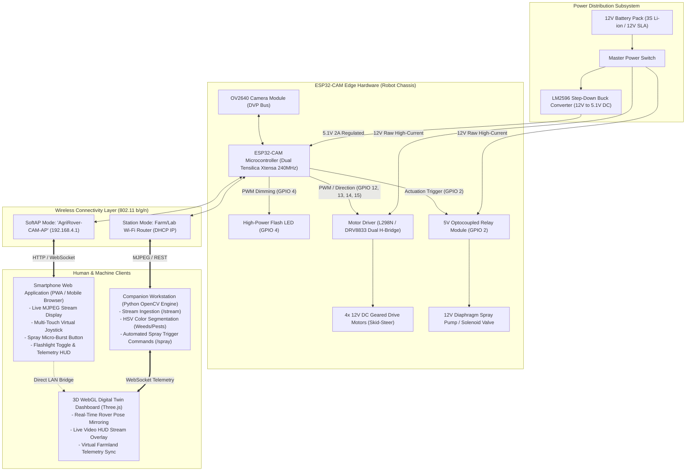
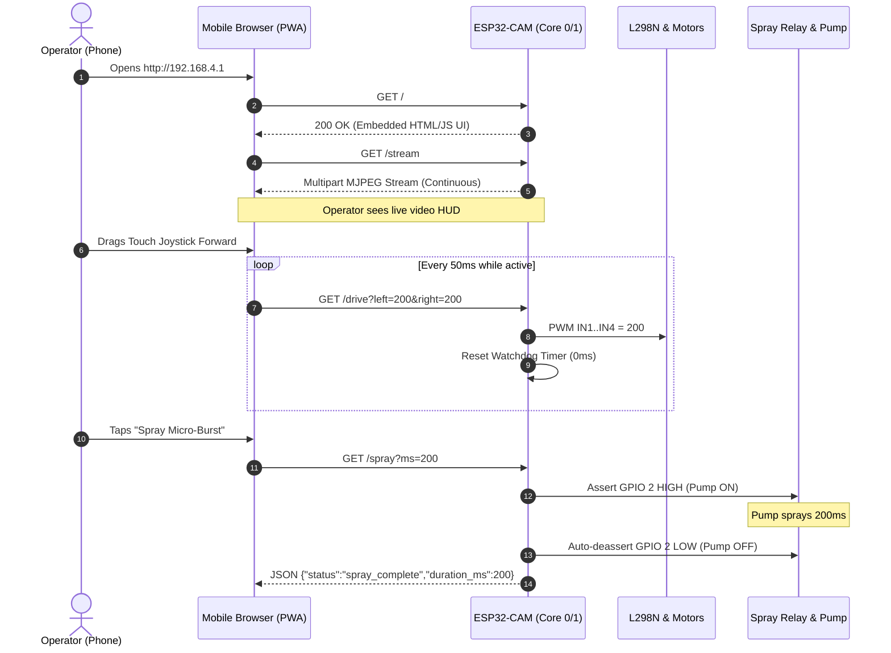
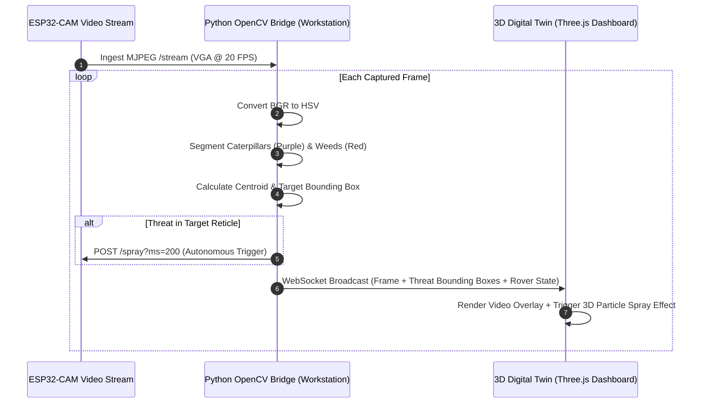

# System Architecture Specification (ARCHITECTURE.md) — Prototype
## Agri Rover: ESP32-CAM Edge IoT Teleoperated & Autonomous Vision Testbed

**Document Version:** 1.0.0  
**Project Code:** MMCA34 — Agri Rover Phase II Prototype Work  
**Target Platform:** AI-Thinker ESP32-CAM (ESP32-D0WDQ6, OV2640, 4MB PSRAM)  
**Status:** Approved Architectural Baseline  

---

## 1. High-Level System Architecture

The Agri Rover ESP32-CAM prototype implements a multi-tier cyber-physical architecture spanning embedded firmware, high-speed wireless video/teleoperation, mobile phone human-machine interface (HMI), offboard computer vision processing, and 3D digital simulation.



---

## 2. Embedded Firmware Architecture (FreeRTOS Dual-Core Execution)

The AI-Thinker ESP32 module houses a dual-core Xtensa 32-bit LX6 microprocessor operating at 240 MHz. To prevent high-throughput video streaming from blocking real-time motor control and safety watchdogs, tasks are strictly decoupled across both CPU cores.

```
┌────────────────────────────────────────────────────────────────────────┐
│                        ESP32 DUAL-CORE DISTRIBUTION                    │
├───────────────────────────────────┬────────────────────────────────────┤
│       CORE 0: NETWORK & VISION    │      CORE 1: KINEMATICS & SAFETY   │
├───────────────────────────────────┼────────────────────────────────────┤
│ • Wi-Fi 802.11 Stack & SoftAP     │ • Hardware Timer LEDC PWM Generator│
│ • HTTP Server (Async / URI Router)│ • Skid-Steer Kinematics Solver     │
│ • DMA Frame Capture Engine        │ • Relay Micro-Burst Pulse Timer    │
│ • MJPEG Chunked Stream Formatter  │ • Failsafe Watchdog Daemon (500ms) │
│ • WebSocket Client Pool Dispatcher│ • Flash LED PWM Intensity Driver   │
│ Priority: 1 (Standard Networking) │ Priority: 3 (High-Priority Control)│
└───────────────────────────────────┴────────────────────────────────────┘
```

### 2.1 Core 0: Video Streaming & Web Server Engine
1. **DMA Video Acquisition:** The OV2640 camera captures frames directly into external PSRAM via Direct Memory Access (DMA) FIFOs, eliminating CPU frame-copy overhead.
2. **Chunked MJPEG Generator:** An asynchronous HTTP handler serves video at `/stream` using `multipart/x-mixed-replace; boundary=frame`. The handler sends continuous JPEG payloads without tearing or re-establishing TCP handshakes.
3. **HTTP Web Server & Static UI Host:** Core 0 serves the complete mobile control interface (HTML, CSS, JavaScript) from flash memory (SPIFFS / PROGMEM) when a client requests `GET /`.

### 2.2 Core 1: Kinematics, Actuation & Safety Daemon
1. **LEDC PWM Motor Driver:** Core 1 drives 4 hardware PWM channels on the ESP32 LEDC peripheral (5 kHz frequency, 8-bit resolution) mapped to GPIO pins 12, 13, 14, and 15.
2. **Micro-Burst Relay Timer:** When a spray command is issued (`/spray?ms=200`), Core 1 switches the relay GPIO (GPIO 2) to active state and registers a non-blocking hardware software timer. After precisely $200\text{ ms}$, the relay de-energizes automatically.
3. **Safety Watchdog:** Core 1 executes a continuous $100\text{ ms}$ interval watchdog. If no valid keep-alive or control packet is received from the mobile phone for $>500\text{ ms}$, the watchdog forces all motor PWM duty cycles to $0\%$, halting the rover instantly.

---

## 3. Network Topologies & Operating Modes

The prototype firmware is designed with an **adaptive dual-mode network manager**:

```
                       ┌─────────────────────────┐
                       │   System Power-On / Boot │
                       └────────────┬────────────┘
                                    │
                                    ▼
                       ┌─────────────────────────┐
                       │ Scan for Known Wi-Fi    │
                       │ Credentials (STA Mode)  │
                       └────────────┬────────────┘
                                    │
                  ┌─────────────────┴─────────────────┐
                  ▼                                   ▼
        [ Router Responded ]               [ Router Timeout (5s) ]
                  │                                   │
                  ▼                                   ▼
     ┌────────────────────────┐          ┌────────────────────────┐
     │ Station Mode Connected │          │ Standalone SoftAP Mode │
     │ IP: 192.168.1.xxx (LAN)│          │ SSID: AgriRover-CAM-AP │
     │ Concurrent Access for: │          │ IP: 192.168.4.1        │
     │ - Phone                │          │ Direct Phone Link      │
     │ - OpenCV Workstation   │          │ In Field / Remote Farm │
     │ - Digital Twin Server  │          └────────────────────────┘
     └────────────────────────┘
```

### 3.1 Mode A: Standalone SoftAP (Field / Autonomous Operation)
- **SSID:** `AgriRover-CAM-AP` (WPA2-PSK: `agrirover123` or open during testing)
- **Default IP:** `192.168.4.1`
- **Subnet:** `255.255.255.0` (Internal DHCP server assigns `192.168.4.2` to phone)
- **Characteristics:** Zero external router dependency. The operator can take the prototype into remote fields, connect their phone directly to the rover's broadcast network, and drive immediately.

### 3.2 Mode B: Station Infrastructure Mode (Lab / Digital Twin Integration)
- **Target Network:** Connected to local 2.4GHz Wi-Fi access point.
- **Assigned IP:** DHCP-assigned address (e.g., `192.168.1.150`).
- **Characteristics:** Enables multi-client routing. A smartphone can teleoperate the rover while a laptop concurrently captures the video stream in Python OpenCV and relays real-time telemetry to the WebGL Digital Twin simulator.

---

## 4. Communication & Control Protocol Specifications

### 4.1 Video Streaming Endpoint
- **URL Path:** `GET http://<ESP32_IP>:81/stream` (or `http://<ESP32_IP>/stream`)
- **MIME Content-Type:** `multipart/x-mixed-replace; boundary=123456789000000000000987654321`
- **Frame Headers:**
  ```http
  --123456789000000000000987654321
  Content-Type: image/jpeg
  Content-Length: [JPEG_BYTES]

  [BINARY JPEG DATA]
  ```

### 4.2 Teleoperation & Motion API
The firmware supports both lightweight REST GET queries (for universal compatibility) and WebSocket packets (for lowest latency):

| Method | Endpoint | Query Parameters | Description | Example Payload / URL |
| :--- | :--- | :--- | :--- | :--- |
| `GET` | `/control` | `cmd={stop,forward,backward,left,right}`<br>`speed={0-255}` | Drives rover in discrete cardinal directions. | `/control?cmd=forward&speed=200` |
| `GET` | `/drive` | `left={-255 to 255}`<br>`right={-255 to 255}` | Independent proportional skid-steer wheel control. | `/drive?left=200&right=150` |
| `GET` | `/spray` | `ms={50-2000}` (default 200) | Triggers timed micro-burst chemical spray pulse. | `/spray?ms=200` |
| `GET` | `/flash` | `val={0-255}` | Adjusts high-power flash LED illumination. | `/flash?val=128` |
| `GET` | `/status` | *None* | Returns JSON telemetry (battery, RSSI, uptime, state). | `{"battery_v":12.4,"rssi":-58,"state":"RUN"}` |

### 4.3 WebSocket Streaming Channel
- **URL:** `ws://<ESP32_IP>/ws`
- **Message Format:** JSON
  - **Inbound Command (Phone -> ESP32):**
    ```json
    { "type": "drive", "left": 180, "right": 180, "watchdog": 1042 }
    ```
  - **Outbound Telemetry (ESP32 -> Phone / Digital Twin):**
    ```json
    { "v_bat": 12.35, "rssi": -62, "fps": 21.4, "spray": false, "led": 0 }
    ```

---

## 5. Software Dataflow & Client Integration

### 5.1 Mobile Phone Human-Machine Interface Dataflow


### 5.2 Companion OpenCV & 3D Digital Twin Integration Dataflow


---

## 6. Architectural Decision Summary (Traceability)

1. **PSRAM-Buffered Camera Capture:** Utilizing 4MB external PSRAM enables high-resolution VGA/SVGA capture without exhausting 520KB internal SRAM, preventing frame drops during concurrent Wi-Fi transfers.
2. **Zero-Install Web App vs. Native Phone App:** Hosting a responsive HTML5 Progressive Web App directly on ESP32 flash guarantees instant compatibility across Android, iOS, tablets, and desktop workstations without app store friction or compilation dependencies.
3. **Decoupled Dual-Core Processing:** Assigning network handling to Core 0 and physical actuation to Core 1 prevents high network latency or streaming congestion from locking motor control or delaying safety stops.
4. **Hardware Safety Watchdog:** Fail-safe auto-braking ensures that if Wi-Fi packets drop during aggressive steering, the vehicle halts within $500\text{ ms}$, eliminating crash hazards.
